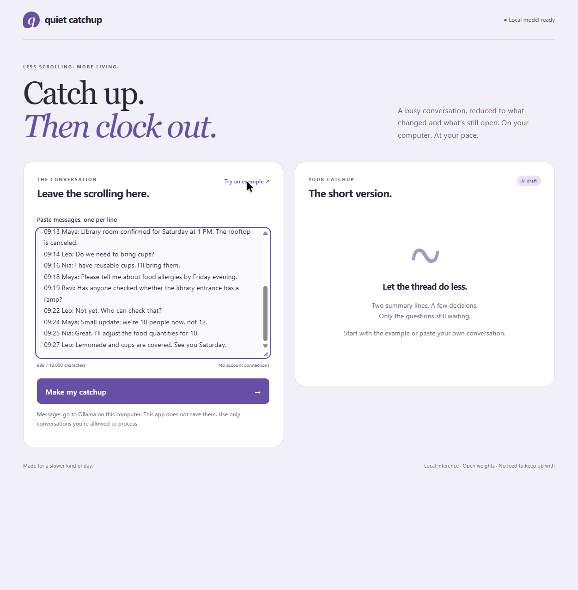

# Quiet Catchup

Catch up. Then clock out.

A local conversation digest for Hacktoberfest Week 3, **Slow and Steady**.
Paste a conversation, get two summary sentences, confirmed decisions, and
still-open requests. Every item links back to numbered original messages.
Edit or remove weak items, check the references, and download a reviewed text
file with the original messages included.



## Run locally

Requires Python 3.11+ and [Ollama](https://ollama.com). There are no Python or
JavaScript application packages to install. The model download is about 2.5 GB;
actual working memory and speed depend on your computer.

1. Install Ollama and download the model: `ollama pull qwen3:4b`.
2. Keep Ollama running at `http://127.0.0.1:11434`.
3. In this directory, run `python app.py`.
4. Open `http://127.0.0.1:8766`.
5. Choose **Try an example**, then **Make my catchup**.

Use 3–200 non-empty message lines and 30–12,000 characters. Keep each message
on its own line. Speaker names and timestamps can remain in the text.

Optional environment variables: `QUIET_PORT` (default `8766`) and `QUIET_MODEL`
(default `qwen3:4b`). Only Qwen3 4B was tested. Large or token-dense inputs can
exceed the model context or timeout; the character limit is not a token guarantee.
Prefer short, relevant threads and check the originals for omissions.

## Demo and evidence

- [56-second silent browser walkthrough](submission/demo/quiet-catchup-walkthrough.webm)
- [First unedited model reply](submission/first-live-reply.json)
- [Reviewed reply](submission/reviewed-reply.json) and [downloaded text](submission/reviewed-catchup.txt)
- [Verification and limitations](submission/VERIFICATION.md)

The video begins after real generation and shows checking a reference, correcting
overconfident wording, reviewing, and downloading. Generation waiting is not
recorded. The app runs on the user's computer; there is no hosted inference demo.

## How it works

```text
Pasted messages → numbered lines → local Ollama / Qwen3 4B
                                → structured JSON
                                → shape + reference-ID checks
                                → editable draft + original messages
                                → person reviews → text download
```

Python's standard-library HTTP server serves three static files and calls
Ollama's `/api/chat` endpoint. The output schema requires exactly two summary
items, up to four decisions, and up to four follow-ups. The server checks field
types, item limits, text lengths, and that each cited line exists. No search,
embeddings, database, scheduler, or account connection is needed.

The model performs the actual interpretation and compression. There is no
canned digest fallback. An unavailable model or invalid reply produces an error.

## Privacy and limits

- The app binds to loopback and accepts local Host/Origin values only.
- Conversation text goes to local Ollama. The app has no cloud model calls,
  analytics, storage, or conversation logging. Reloading clears the working draft.
- Downloading explicitly saves the edited draft **and original messages**.
  Browser/OS and Ollama behavior are outside this app's storage guarantees.
- Model weights and software must be downloaded first. After setup, the app's
  inference path uses local endpoints. This is a local development server, not
  a production multi-user deployment.
- Valid references only prove that message IDs exist. They do not prove factual
  support, completeness, correct interpretation, or resistance to prompt injection.
- Decisions can be mislabeled, promises can be overstated, and details can be
  missed. Always compare consequential claims with the original conversation.
- Review is a person's checkbox, not an automated accuracy certificate. Editing
  text or removing an item clears review. Changing the source clears the digest.
- No automatic chat access or background monitoring. Paste only text you may process.

## Check

```text
python -m unittest -v
node --check static/app.js
python submission/live_check.py
```

The first command runs 13 automated boundary and HTTP tests with mocked model
responses. Node is needed only for the optional syntax check; it is not needed
to run the app. The last command calls the real model twice and overwrites the
two fictional live-check evidence files. It can take several minutes.

## Credits and licensing

Created from scratch on October 21, 2026, within the Week 3 challenge window.
Codex implemented and tested this project and prepared the submission under
Kartikey Tiwari's instruction. Earlier challenge project code was not reused.

The source-ID boundary was informed by Ranknod's
[Check AI Citations Against Retrieved Source IDs](https://dev.to/ranknod/check-ai-citations-against-retrieved-source-ids-3hi8)
and Enhanciar's
[Your AI cited a real file. It still lied to you.](https://dev.to/enhanciar_ai_96a4ba4877e3/how-we-make-an-llm-cite-every-answer-down-to-fileline-and-check-the-citation-is-telling-the-truth-hmj).
Implementation is independent; their source code was not copied.
Ollama's [structured-output documentation](https://docs.ollama.com/capabilities/structured-outputs)
describes the schema API used here.

Application code: [MIT](LICENSE). Model weights are downloaded separately and
retain their [upstream Qwen3 4B license](https://huggingface.co/Qwen/Qwen3-4B).
No partner prize category is claimed.
